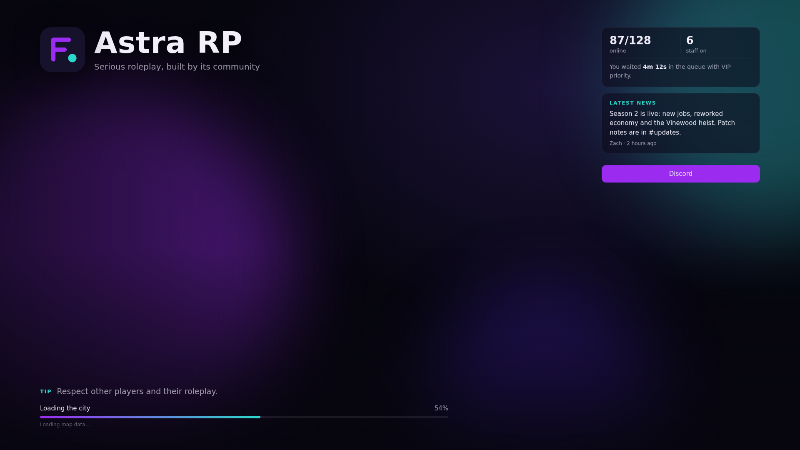

# fiveload

A loading screen with a progress bar that follows the game's real loading stages, rotating tips, music, your links, and live server info.



## Features

- A progress bar driven by FiveM's own loading events, with the current stage written out ("Loading the city") and the game's log line under it. It never jumps backwards.
- Your logo, name, tagline and two accent colours
- Background images or videos that fade from one to the next, or an animated background if you don't add any
- Rotating tips
- Music with previous, play/pause and next, and a volume slider. The player's volume is remembered. Space toggles it.
- Buttons for your Discord, rules and website. They open in the player's browser.
- Your own announcements
- Players online and staff online
- Fades out with the music once the game is ready, then your multicharacter or spawn selector takes over

Plain HTML, CSS and JS with no build step, so you can change anything. Nothing loads from outside the resource.

## With the others

- **[joinqueue](https://github.com/1amZach/joinqueue):** players see how long they waited in the queue and their priority.
- **[fivecord](https://github.com/1amZach/fivecord):** shows how many staff are online, and the latest post from a Discord channel you pick (`Config.channels.news` in fivecord's config). Good for patch notes.

## Install

1. Drop `fiveload` into your resources and add to `server.cfg`:

   ```
   ensure fiveload
   ```

   Only one loading screen can run, so remove any other.

2. Edit `html/config.js`. Put your logo, backgrounds and music in `html/media` and list them there.

## Config

Everything is in `html/config.js`:

| Key | |
|---|---|
| `name`, `tagline`, `logo` | Leave `name` empty to use your server's name |
| `accent`, `accent2` | Progress bar and highlight colours |
| `backgrounds`, `slideSeconds` | Images (`.jpg`, `.png`, `.webp`) or videos (`.webm`, `.mp4`) |
| `music`, `volume`, `shuffle` | `{ file, title, artist }` for each song |
| `tips`, `tipSeconds` | |
| `announcements` | `{ title, text }` panels on the right |
| `links` | Buttons. Ones with no `url` are hidden |

Keep videos and music small: every player downloads them before they can load in.

## Support

Made by **IamZach**. Questions, bugs or ideas: [discord.gg/agn](https://discord.gg/agn)

## License

MIT
